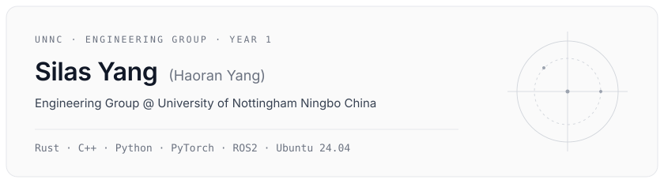

<div align="center">

[🇨🇳 简体中文](./README.md) &nbsp;|&nbsp; **🌐 English**

<br />



</div>

<br />

## 👋 About Me

Hi! I'm **Silas Yang (Haoran Yang)**, a **Year 1 Engineering Group** student at the **University of Nottingham Ningbo China (UNNC)**.

Working primarily on **Ubuntu 24.04**, I enjoy exploring **systems programming, Rust terminal code agents, robotics (ROS2), and deep learning (PyTorch)**—building clean, practical tools along the way.

<details>
<summary>🖥️ <code>$ cat ~/.profile</code> — Terminal Profile Card</summary>

```toml
[developer]
name = "Silas Yang (Haoran Yang)"
university = "University of Nottingham Ningbo China"
group = "Engineering Group (Year 1)"

[environment]
os = "Ubuntu 24.04"
languages = ["Rust", "C++", "Python"]
frameworks = ["PyTorch", "ROS2"]

[contact]
personal = "haoranyoung09@gmail.com"
education = "ssyhy21@nottingham.edu.cn"
```

</details>

---

## 🛠️ Tech Stack

<div align="center">

| Category | Technologies |
| :---: | :--- |
| **Languages** |    |
| **AI & Robotics** |   |
| **OS & Platform** |  |

</div>

---

## 🚀 Featured Projects

<table>
  <thead>
    <tr>
      <th width="26%">Project</th>
      <th width="22%">Focus</th>
      <th width="52%">Description</th>
    </tr>
  </thead>
  <tbody>
    <tr>
      <td>
        <strong>🦀 <a href="https://github.com/haoranyoung09-sys/original-agent">original-agent</a></strong>
      </td>
      <td>
        <code>Rust</code> <code>PowerShell</code><br />
        <code>Code Agent</code>
      </td>
      <td>
        PowerShell terminal Code Agent built with Rust, based on the community open-source Rust version of the Anthropic SDK.
      </td>
    </tr>
    <tr>
      <td>
        <strong>🩺 <a href="https://github.com/haoranyoung09-sys/ci-diagnose">ci-fail-diagnose</a></strong>
      </td>
      <td>
        <code>CI/CD</code> <code>Diagnostics</code><br />
        <code>GitHub Actions</code>
      </td>
      <td>
        CI failed, or GitHub Actions is red? Classify the log, quote redacted evidence, propose one minimal fix, and say how to verify it. Advisory only. Not a merge decision.
      </td>
    </tr>
    <tr>
      <td>
        <strong>📝 <a href="https://github.com/haoranyoung09-sys/Things-To-Do">Things-To-Do</a></strong>
      </td>
      <td>
        <code>Planning</code> <code>To-Do</code>
      </td>
      <td>
        A simple project used to record plans and to-dos.
      </td>
    </tr>
  </tbody>
</table>

---

## 📬 Contact Me

Feel free to reach out for tech discussions, projects, or academic collaboration!

<div align="center">

[](mailto:haoranyoung09@gmail.com)
[](mailto:ssyhy21@nottingham.edu.cn)

</div>

- 📫 **Personal Email**: [haoranyoung09@gmail.com](mailto:haoranyoung09@gmail.com)
- 🎓 **Education Email**: [ssyhy21@nottingham.edu.cn](mailto:ssyhy21@nottingham.edu.cn)

<br />

<div align="center">
  
</div>
