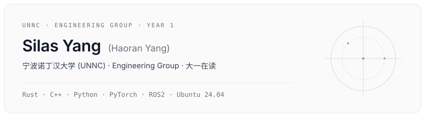

<div align="center">

**🇨🇳 简体中文** &nbsp;|&nbsp; [🌐 English](./README.en.md)

<br />



</div>

<br />

## 👋 关于我

你好！我是 **Silas Yang (Haoran Yang)**，目前是 **宁波诺丁汉大学（University of Nottingham Ningbo China, UNNC）Engineering Group** 的大一学生。

我热衷于在 **Ubuntu 24.04** 环境下探索 **系统编程、Rust 终端工具 / Code Agent、机器人（ROS2）与深度学习（PyTorch）**，喜欢用简洁可靠的工程工具解决实际问题。

<details>
<summary>🖥️ <code>$ cat ~/.profile</code> —— 展开终端个人名片</summary>

```toml
[developer]
name = "Silas Yang (Haoran Yang)"
university = "University of Nottingham Ningbo China"
group = "Engineering Group (Year 1)"

[environment]
os = "Ubuntu 24.04"
languages = ["Rust", "C++", "Python"]
frameworks = ["PyTorch", "ROS2"]

[contact]
personal = "haoranyoung09@gmail.com"
education = "ssyhy21@nottingham.edu.cn"
```

</details>

---

## 🛠️ 技术栈

<div align="center">

| 领域 | 技术与工具 |
| :---: | :--- |
| **编程语言** |    |
| **AI 与机器人** |   |
| **系统环境** |  |

</div>

---

## 🚀 个人项目

<table>
  <thead>
    <tr>
      <th width="26%">项目名称</th>
      <th width="22%">关键词</th>
      <th width="52%">项目简介</th>
    </tr>
  </thead>
  <tbody>
    <tr>
      <td>
        <strong>🦀 <a href="https://github.com/haoranyoung09-sys/original-agent">original-agent</a></strong>
      </td>
      <td>
        <code>Rust</code> <code>PowerShell</code><br />
        <code>Code Agent</code>
      </td>
      <td>
        基于社区开源的 Rust 版 Anthropic SDK，使用 Rust 构建的 PowerShell 终端 Code Agent。
      </td>
    </tr>
    <tr>
      <td>
        <strong>🩺 <a href="https://github.com/haoranyoung09-sys/ci-diagnose">ci-fail-diagnose</a></strong>
      </td>
      <td>
        <code>CI/CD</code> <code>Diagnostics</code><br />
        <code>GitHub Actions</code>
      </td>
      <td>
        CI 失败或 GitHub Actions 标红？自动对日志进行分类、引用脱敏后的关键证据、提出最小修复方案并说明验证方式（仅作辅助建议，不作为合并决策）。
      </td>
    </tr>
    <tr>
      <td>
        <strong>📝 <a href="https://github.com/haoranyoung09-sys/Things-To-Do">Things-To-Do</a></strong>
      </td>
      <td>
        <code>Planning</code> <code>To-Do</code>
      </td>
      <td>
        一个用于记录个人计划与待办事项的轻量简洁项目。
      </td>
    </tr>
  </tbody>
</table>

---

## 📬 联系我

欢迎交流技术、工程项目或学术话题！

<div align="center">

[](mailto:haoranyoung09@gmail.com)
[](mailto:ssyhy21@nottingham.edu.cn)

</div>

- 📫 **个人邮箱**：[haoranyoung09@gmail.com](mailto:haoranyoung09@gmail.com)
- 🎓 **教育邮箱**：[ssyhy21@nottingham.edu.cn](mailto:ssyhy21@nottingham.edu.cn)

<br />

<div align="center">
  
</div>
